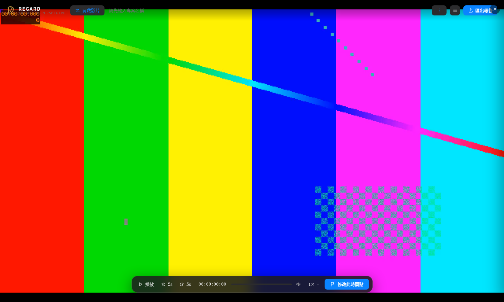
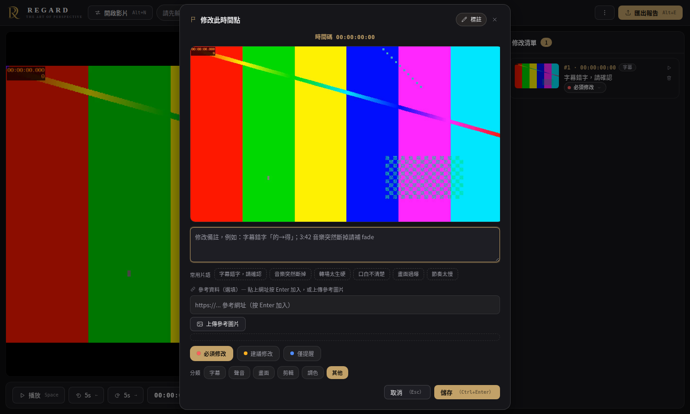
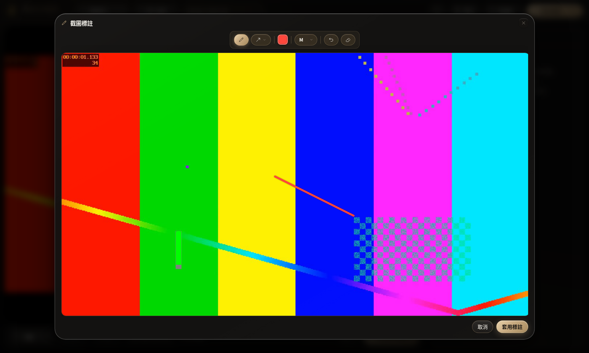
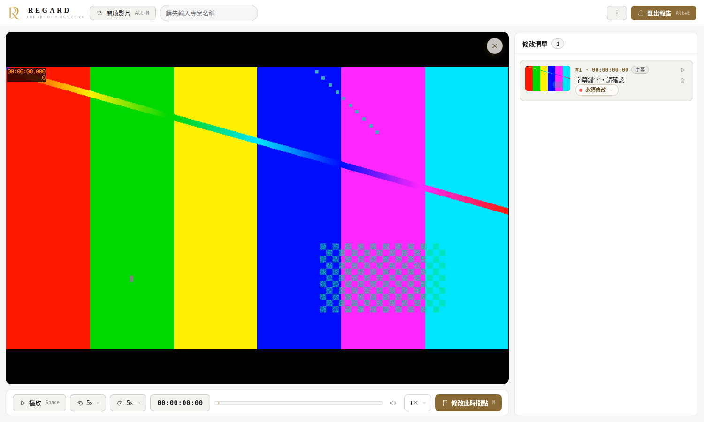
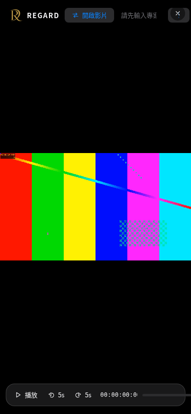
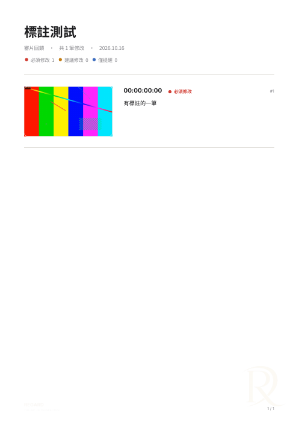

# REGARD

> The Art of Perspective — see the essence of the image, define a higher standard.

A local-first video review tool. Load a video in your browser, drop time-coded revision marks, annotate screenshots, attach references, then export a **PDF / Excel report** you can send straight to clients or post-production.

Everything runs on your own machine — **your video is never uploaded and never touches a server**.

[繁體中文](./README.md) · [Live demo](https://kane1a.github.io/REGARD/regard.html)



## Features

- **Time-coded marks** — hit `M` at the moment that needs a change (or click "Mark this point"); timecodes are frame-accurate (`HH:MM:SS:FF`, frame rate auto-detected)
- **Screenshot annotation** — pen, arrow, line, rectangle, ellipse; custom colors (SV picker + hex codes), four stroke widths
- **Severity levels** — Must Fix / Suggested / FYI, switchable directly on each card
- **References** — attach URL links (press Enter to add) or upload reference images per mark
- **PDF export** — embedded Noto Sans TC + Inter fonts, CJK-safe, selectable/searchable text, auto layout of screenshots and reference images
- **Excel export** — screenshots and reference images embedded in cells, with filters and severity color blocks
- **Video info** — filename, container, codec, resolution, frame rate, bitrate, audio tracks; deep moov parsing for MP4/MOV
- **Privacy-first** — no install, no sign-up, no upload; works offline (just double-click `regard.html`)
- **Bilingual + themes** — one-click 中文/EN switch and dark/light themes; mobile gets a compact menu

| Mark dialog | Screenshot annotation |
|---|---|
|  |  |

| Light theme | Mobile |
|---|---|
|  |  |

### Export sample (PDF)



## Usage

1. Open [REGARD](https://kane1a.github.io/REGARD/regard.html) (or download and double-click `regard.html`)
2. Drop a video in, or click "Choose video file" (mp4 / mov / webm and other common formats)
3. At the moment that needs a change, press `M`: write a note, pick a severity
4. For visual proof, click "Annotate" to circle the issue on the screenshot
5. Enter a project name top-left, click "Export report" → PDF or Excel

### Keyboard shortcuts

| Key | Action |
|---|---|
| `Space` | Play / pause |
| `←` `→` | Back / forward 5 seconds |
| `M` | Add a mark at this time |
| `Shift`+`<` `>` | Slower / faster playback |
| `I` | Video info |
| `Alt`+`E` | Open export menu |
| `Alt`+`N` | Open a new video (asks first if you have unsaved marks) |
| `?` | Shortcut cheatsheet |
| `Esc` | Close dialog |

## Privacy

- Video is read through a browser blob URL only — **it is never uploaded anywhere** (try airplane mode)
- jsPDF, ExcelJS and the font files all live in `lib/` and `fonts/` — **zero external requests**
- Marks live in memory only and vanish when the tab closes; no cookies, no trackers

## FAQ

**Q: Pro formats (ProRes, XAVC, HEVC 10-bit, MXF) won't play?**
Browsers can't preview those codecs. The app will suggest transcoding an H.264 MP4 proxy first:
`ffmpeg -i source -c:v libx264 -crf 20 -c:a aac proxy.mp4`

**Q: Garbled CJK text in PDF?**
The PDF needs `fonts/fonts.js` (Noto Sans TC). If self-hosting, keep the `fonts/` directory intact; the font loads lazily on first PDF export so it doesn't slow down startup.

**Q: Works offline?**
Yes. Download the whole folder and double-click `regard.html` — exports work the same.

## File layout

```
REGARD/
├── regard.html          # the app (single file, no build step)
├── lib/
│   ├── jspdf.umd.min.js # PDF generation (vendored)
│   └── exceljs.min.js   # Excel generation (vendored)
├── fonts/
│   └── fonts.js         # Noto Sans TC + Inter (embedded in PDF, lazy-loaded)
└── docs/screenshots/    # README screenshots
```

## License

MIT © kane1a
